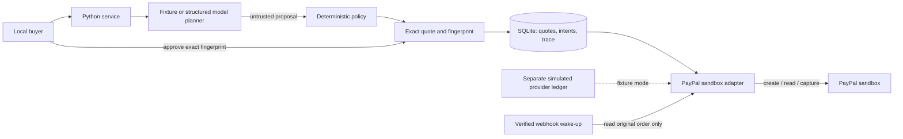

# Architecture and security notes

## Authority and trust

The local browser submits a brief. A planner proposes SKU/quantity pairs, explanations and questions. Deterministic policy computes money from the fixed catalog, validates stock/currency/budget, and creates a full quote. The buyer approves that quote's SHA-256 fingerprint. The service owns payment state. Model text cannot call payment tools, select endpoints, set prices, mutate approvals or access credentials.

Fixture mode persists provider effects in a separate table and transaction from the local intent/receipt. This lets a provider success survive a dropped local response. It simulates failure boundaries; it does not reproduce all PayPal behavior.

## State machine

| State | Meaning / allowed action |
| --- | --- |
| DRAFT | Revise, approve exact quote, or cancel locally |
| APPROVED | Revision invalidates approval; create once or cancel locally |
| CREATING | Intent persisted; interrupted process recovers CREATE_UNKNOWN |
| CREATE_UNKNOWN | Creation may have succeeded; investigate saved request ID manually; no replay |
| AWAITING_PAYER | PayPal approval (or explicit fixture action), reconcile, or cancel locally |
| READY_TO_CAPTURE | Refresh exact provider order, then capture once; reconcile or cancel locally |
| CAPTURING | Intent persisted; interrupted process recovers CAPTURE_UNKNOWN |
| CAPTURE_UNKNOWN | Read original order; no capture/create replay |
| PAYMENT_PENDING | Await settlement/read original order; never claim paid |
| COMPLETED | Verified completed capture; export historical evidence |
| REVIEW_REQUIRED | Reconcile or investigate manually; no payment retry |
| CANCELLED | Stop app-initiated capture; reads may still reveal provider facts |

A service lock serializes transitions in one process. SQLite WAL with synchronous FULL commits each intent and stable UUID request ID before a provider invocation. An OS file lock prevents two servers owning one data directory. A crash after provider capture but before receipt persistence recovers as unknown; a GET can find the capture. Unknown creation without an order ID cannot be looked up by an invented API; it stops for merchant investigation.

PayPal supports idempotency within retention limits. This implementation conservatively never automatically replays create/capture, even with the same key. Duplicate calls return existing state; concurrent calls send one invocation per commitment. Authentication rejection does not cause retry. A failed GET after capture remains unknown: lookup authentication failure says nothing about capture success.

Before capture and during reconciliation, policy requires the original order ID, CAPTURE intent, one purchase unit, local references, exact seller merchant ID, USD total and every SKU/name/quantity/unit price. Verified completion requires one completed capture with matching amount/currency and completed order status. Missing/malformed evidence stops for review. Because capture responses may omit original fields, a returned capture is followed by a full order GET.

Unresolved outcomes block other checkout creation in the same browser session. This is not a universal exactly-once or never-double-charged guarantee. Another browser/session, deleted state, external merchant activity, compromised host and provider failures are outside app authority. There is no button that erases a real uncertain payment.

## Webhooks

Actual sandbox events require the documented signature-verification postback using the registered webhook ID and received transmission headers/object. A supported verified event only locates a known original order and triggers GET; event text never proves payment or triggers capture. IDs deduplicate application; stale events cannot regress COMPLETED or revive cancellation. Failed GET returns 503 without consuming the ID. Unknown verified types/orders are acknowledged and ignored.

Authenticated fixture events use a separate fixture-only API. They are not cryptographically verified PayPal notifications. The loopback listener cannot receive external PayPal HTTPS webhooks by itself; authorized HTTPS forwarding and registered-app testing remain pending.

## Browser/server controls

- Random persisted session cookies (`HttpOnly`, `SameSite=Lax`) scope purchases. Lax keeps the session on top-level PayPal return. All browser mutations require exact loopback Origin plus a separate CSRF token. Callback query text is never payment proof.
- Loopback binding and exact Host checks reduce DNS rebinding exposure. Explicit static routes prevent traversal or database/config/source downloads.
- Untrusted content uses `textContent`, not HTML/Markdown. CSP restricts local resources and disables framing/plugins/inline scripts. Approval URLs must be HTTPS PayPal sandbox URLs; links use `noopener noreferrer`.
- Size-bounded JSON, bound SQL parameters and sanitized errors. Provider bodies, raw request URLs and secrets are not logged. Server keys are absent from browser bootstrap, purchases and evidence exports.
- External execution requires explicit adapter modes and `COMMITGUARD_ALLOW_NETWORK=1`. Origins are fixed to PayPal sandbox/OpenAI, redirects are rejected, TLS validation stays enabled and calls time out. No production PayPal origin is implemented.
- New state directories use 0700 and database files 0600. Quote hashes detect approval mismatch; they do not protect against a hostile local OS owner. Local session scoping is not a production account identity system.

## Limits

Local single-operator prototype only: no real payments, card handling, refund, fulfillment, inventory reservation, delivery, production identity, multi-currency conversion or automatic retry scheduler. Stock is a per-quote fixture limit; fixture tax/shipping are zero with NO_SHIPPING checkout. Historical completed evidence does not promise protection against later refunds/disputes. Real model quality, external contracts, human assistive-technology testing and production hosting hardening remain separate work.

## Durable intent and historical evidence

Local cancellation is an independent persisted timestamp, not a display-state convention. Every capture/commitment path checks it; startup recovers older cancellation intent from its durable trace. A later provider mismatch can display review, and external settlement can display pending/completed evidence, while local payment authority remains revoked. Provider reconciliation cannot reauthorize the app.

The first observed capture ID and its last validated evidence remain persisted independently of an app capture attempt. Preflight can discover an externally completed/pending fixture capture and recover its exact ID without sending a new POST. Later missing/stale evidence becomes unknown and cannot make the order capturable again; a changed capture identity requires review and retains the original proof. Completed legacy rows missing receipt fields are re-read instead of short-circuited. The UI offers proof recovery and hides incomplete receipts.
